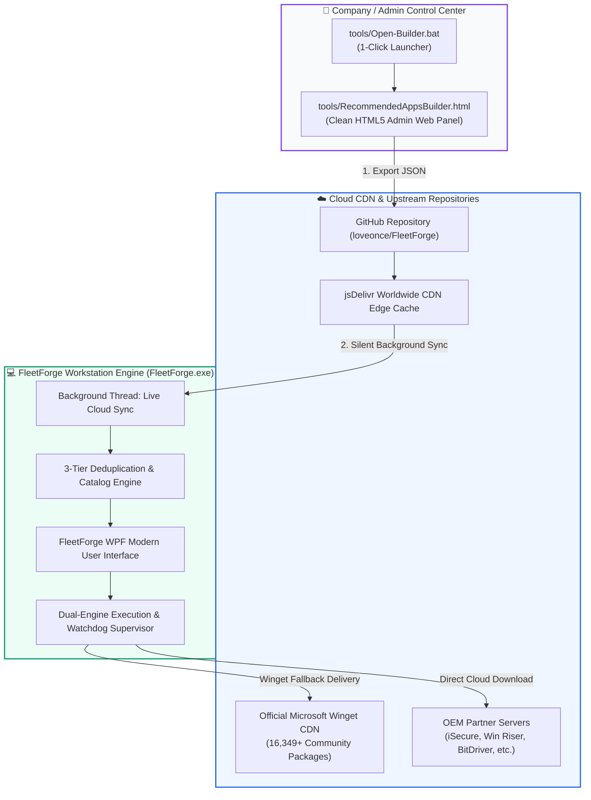
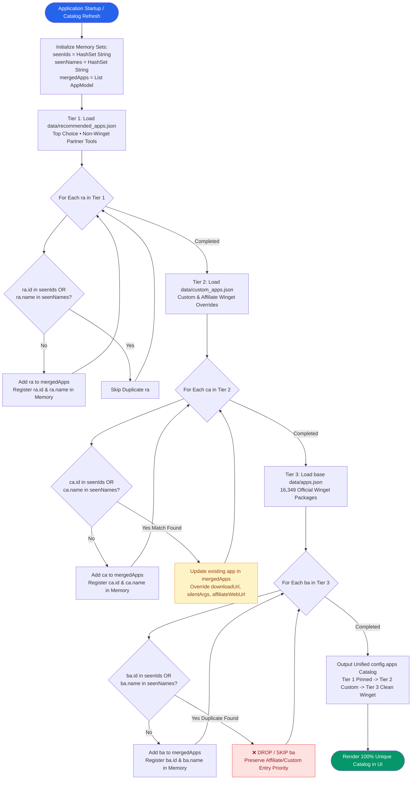
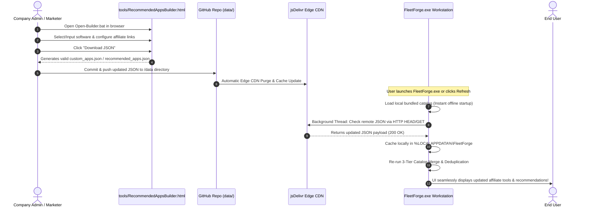
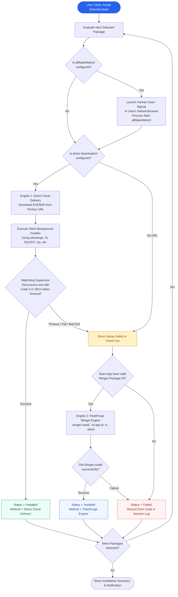
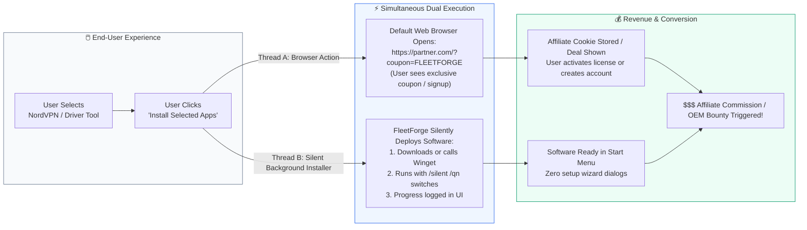
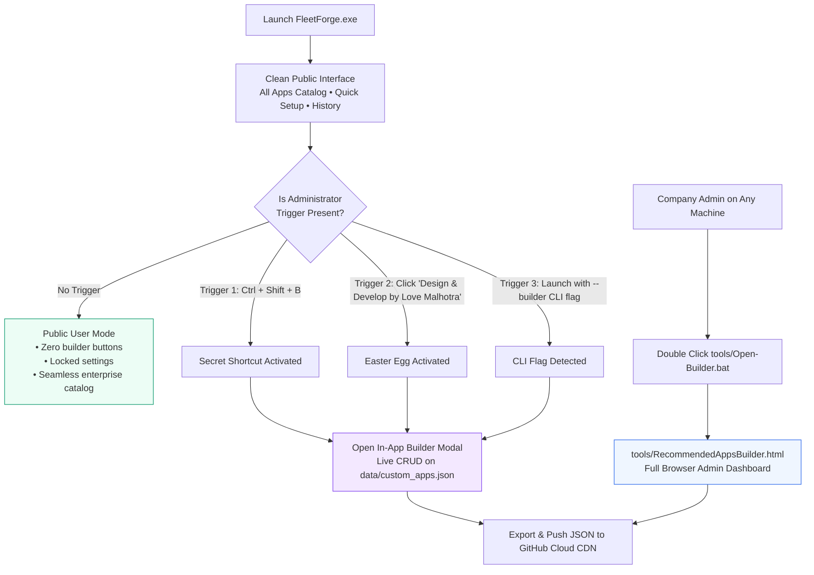
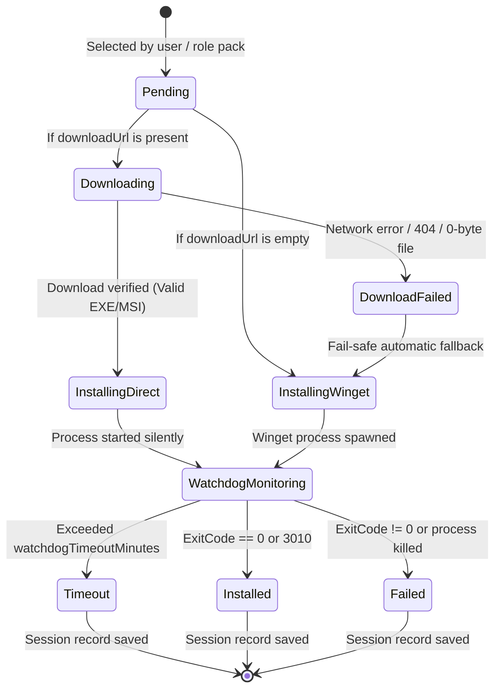

# FleetForge — System Architecture & Workflow Flowcharts

> **Platform:** FleetForge — Zero-Touch Machine Setup & Enterprise Software Deployment  
> **Author & Architect:** Love Malhotra  
> **Target Environment:** Windows 10 / 11 (x64) • .NET Framework 4.8 / WPF  
> **Document Version:** 2.6.4 • Production Architecture Reference  

---

## 📑 Table of Contents
1. [High-Level System Overview](#1-high-level-system-overview)
2. [3-Tier Catalog Merging & Smart Dual-Key Deduplication Engine](#2-3-tier-catalog-merging--smart-dual-key-deduplication-engine)
3. [Zero-Redeployment Cloud Synchronization Flow](#3-zero-redeployment-cloud-synchronization-flow)
4. [Dual-Engine Execution & Fail-Safe Fallback Matrix](#4-dual-engine-execution--fail-safe-fallback-matrix)
5. [Hybrid Web-Redirect Affiliate Monetization Workflow](#5-hybrid-web-redirect-affiliate-monetization-workflow)
6. [Company Admin Panel & Secret Access Security Topology](#6-company-admin-panel--secret-access-security-topology)
7. [Component State Machine](#7-component-state-machine)

---

## 1. High-Level System Overview

The diagram below illustrates the end-to-end ecosystem of FleetForge, connecting client workstations, cloud CDNs, the standalone HTML Admin Builder, and upstream software repositories.

---

## 2. 3-Tier Catalog Merging & Smart Dual-Key Deduplication Engine

FleetForge merges three distinct catalogs into one unified software store with **zero duplicate entries** and **zero modifications** to the core `apps.json` database.

---

## 3. Zero-Redeployment Cloud Synchronization Flow

How companies push new software, update affiliate URLs, and change pricing deals worldwide without releasing a new `.exe` installer.

---

## 4. Dual-Engine Execution & Fail-Safe Fallback Matrix

FleetForge guarantees 100% installation reliability through an automated two-stage execution pipeline.

---

## 5. Hybrid Web-Redirect Affiliate Monetization Workflow

How FleetForge generates revenue for software publishers, MSPs, and affiliates without adding friction to the end user.

---

## 6. Company Admin Panel & Secret Access Security Topology

FleetForge completely hides catalog builder tools from everyday end-users while giving authorized administrators immediate access through three discreet pathways.

---

## 7. Component State Machine

State transitions of a package during deployment in the FleetForge runtime engine.

---

*Document generated and maintained for the **FleetForge** open enterprise setup ecosystem.*  
*Architected by **Love Malhotra**.*
