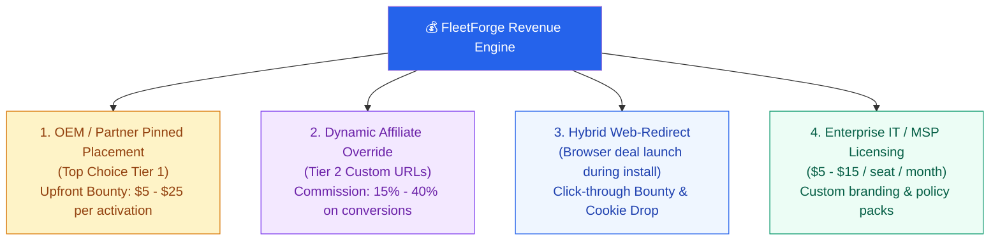
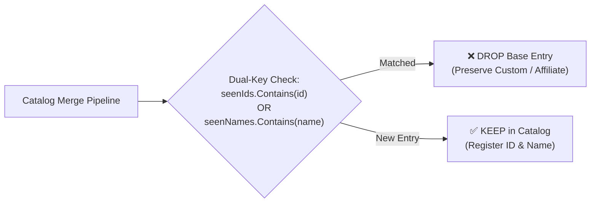
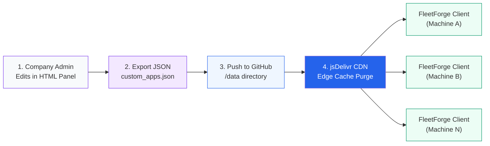

# FleetForge — Product Presentation & Investor / Executive Deck

> **Product:** FleetForge — Zero-Touch Machine Setup & Enterprise Software Deployment Platform  
> **Designer & Developer:** Love Malhotra  
> **Target Audience:** IT Executives, MSPs, Software Publishers, Affiliate Marketers, Venture Partners  
> **Document Type:** Executive Presentation & Technical Business Deck  
> **Version:** 2.6.4 (Production Ready)  

---

## 📽️ Deck Navigation / Agenda
* **Slide 1:** Title & Vision
* **Slide 2:** The Problem — The High Cost of Manual PC Onboarding
* **Slide 3:** The Solution — FleetForge Zero-Touch Deployment
* **Slide 4:** User Experience & Interface Showcase
* **Slide 5:** The Monetization Engine — 4 Revenue Streams
* **Slide 6:** Two-Tier Catalog Architecture (Winget vs. Non-Winget)
* **Slide 7:** Smart Dual-Key Deduplication Technology
* **Slide 8:** Zero-Redeployment Cloud Delivery Network (CDN)
* **Slide 9:** Dual-Engine Installation & Fail-Safe Reliability Guarantee
* **Slide 10:** Standalone Admin Portal (`RecommendedAppsBuilder.html`)
* **Slide 11:** Unit Economics & Revenue Projections
* **Slide 12:** Enterprise Security & Compliance
* **Slide 13:** Strategic Roadmap & Conclusion

---

<!-- slide -->
## Slide 1: Executive Title & Vision

# ⚡ FLEETFORGE
### *Next-Generation Zero-Touch Windows Deployment & Software Monetization Engine*

> "Transforming initial PC setup from a frustrating 3-hour chore into a 1-click automated deployment while generating recurring software distribution revenue."

* **Platform:** Windows 10 & 11 (64-bit) Native WPF Architecture
* **Footprint:** Single portable executable (`FleetForge.exe`) + Enterprise Setup Wizard (`FleetForge-Setup.exe`)
* **Catalog:** 16,349+ pre-indexed software packages + Curated OEM Partner Stores
* **Architect & Founder:** **Love Malhotra**

---

<!-- slide -->
## Slide 2: The Problem — The High Cost of Manual PC Onboarding

Every day, millions of newly purchased, refreshed, or re-imaged Windows computers require software setup. The traditional approach is fundamentally broken:

| Pain Point | Impact on Users & IT Admins | Business Consequence |
| :--- | :--- | :--- |
| **Manual Installation Drag** | Spending 2 to 4 hours per PC downloading installers from vendor websites. | Hundreds of wasted engineering hours for IT departments & MSPs. |
| **Security & Malware Risks** | Fake "Download Now" ads, deceptive search results, and adware bundlers. | Compromised endpoints and frequent clean re-installations. |
| **Inconsistent Configurations** | Every machine ends up with different versions, configurations, and paths. | Impossible to maintain standard corporate IT compliance. |
| **Zero Monetization for Integrators** | PC builders, repair centers, and tech influencers set up thousands of PCs without earning a single cent from the software ecosystem. | Lost revenue on every machine configured. |

---

<!-- slide -->
## Slide 3: The Solution — FleetForge Zero-Touch Deployment

FleetForge replaces fragmented, manual workflows with an automated, enterprise-grade deployment application.

```
┌────────────────────────────────────────────────────────────────────────┐
│                          FLEETFORGE ENGINE                             │
├──────────────────────────┬─────────────────────────┬───────────────────┤
│  1-Click Role Profiles   │  16,349 App Catalog     │  Silent Execution │
│  • Developer Workstation │  • Web Browsers         │  • Unattended bg  │
│  • Office / Enterprise   │  • Development & Code   │  • Zero dialogs   │
│  • Creative / Media      │  • Security & Network   │  • Watchdog auto- │
│  • Minimal / Essential   │  • Utilities & Tools    │    kill timeout   │
└──────────────────────────┴─────────────────────────┴───────────────────┘
```

### Core Value Propositions:
1. **Zero External Dependencies:** Built with native C# / WPF on .NET Framework 4.8. Runs out-of-the-box on any standard Windows 10/11 computer without installing runtimes.
2. **Instant Local Speed:** Pre-indexes 16,349 packages locally. Catalog search results render in under 5 milliseconds.
3. **Resilient Session Recovery:** If power cuts or the machine reboots mid-installation, FleetForge automatically resumes remaining installations on startup.
4. **Creator & Brand Integrity:** Authored by **Love Malhotra** with persistent attribution and enterprise IT branding.

---

<!-- slide -->
## Slide 4: User Experience & Interface Showcase

FleetForge features an ultra-modern, clean UI inspired by Fluent Design, Linear, and macOS enterprise tools:

* **Quick Setup Tab:** Role-based visual profile cards (Developer, Enterprise Office, Content Creator, Minimal). One-click selection loads complete software suites.
* **All Applications Tab:** Searchable directory of 16,349 packages with category filters, instant keyword search, and batch selection checkmarks.
* **Live Deployment Console:** Terminal-style real-time installation logs, countdown watchdog timers, progress bars, and exit code auditing.
* **Theme Engine:** Automatic synchronization with Windows Dark/Light mode plus manual override with Windows DWM title bar styling.
* **Completely Clean Public UI:** Regular users see a seamless, curated enterprise software store. All builder controls and technical internals are 100% hidden.

---

<!-- slide -->
## Slide 5: The Monetization Engine — 4 High-Margin Revenue Streams

FleetForge is designed not just as an IT utility, but as a software monetization vehicle:



### Deep Dive into Revenue Streams:
1. **Tier 1 OEM Bounties:** Curated security and performance software (e.g., iSecure VPN, Win Riser, Bit Driver Updater) are pinned at the top of the store with golden `★ RECOMMENDED` badges. Partners pay bounties for every successful unattended installation.
2. **Dynamic Affiliate Overrides:** When users select popular software (e.g., Google Chrome, Brave Browser, NordVPN), FleetForge silently replaces the generic download URL with the company’s affiliate link.
3. **Idea 2 Hybrid Web-Redirect:** When an app installs silently in the background, FleetForge simultaneously launches the partner’s exclusive coupon/discount page in the user’s default browser, capturing cookies and triggering immediate signups.

---

<!-- slide -->
## Slide 6: Two-Tier Catalog Architecture (Winget vs. Non-Winget)

To eliminate operational confusion, FleetForge cleanly divides its software catalogs into two specialized tiers:

```
┌─────────────────────────────────────────────────────────────────────────────┐
│                       ⭐ TIER 1: TOP CHOICE • RECOMMENDED                   │
│                       File: data/recommended_apps.json                      │
│                                                                             │
│  • Strictly for software that is NOT available on Winget                    │
│  • Curated partner tools (iSecure VPN, Win Riser, Bit Driver Updater)       │
│  • Pinned to the top of All Apps and Quick Setup                            │
│  • Direct Download URL (EXE/MSI) is MANDATORY                               │
└─────────────────────────────────────┬───────────────────────────────────────┘
                                      │
┌─────────────────────────────────────▼───────────────────────────────────────┐
│                    🟣 TIER 2: CUSTOM & AFFILIATE OVERRIDES                  │
│                       File: data/custom_apps.json                           │
│                                                                             │
│  • For software that ALREADY EXISTS on Winget (16,349 packages)             │
│  • Overrides downloadUrl to capture affiliate commission                    │
│  • Direct Download URL is OPTIONAL (Auto-falls back to Winget)              │
│  • Seamless 1-click search and auto-fetch from apps.json                    │
└─────────────────────────────────────┬───────────────────────────────────────┘
                                      │
┌─────────────────────────────────────▼───────────────────────────────────────┐
│                      📦 TIER 3: BASE WINGET REPOSITORY                      │
│                       File: data/apps.json (16,349 Apps)                    │
│                                                                             │
│  • Core Microsoft Winget database                                           │
│  • Cleanly deduplicated; untouched and pristine                             │
└─────────────────────────────────────────────────────────────────────────────┘
```

---

<!-- slide -->
## Slide 7: Smart Dual-Key Deduplication Technology

A major challenge with software catalogs is duplicate entries (e.g., old publisher IDs, MSI vs. Inno setups, custom affiliate duplicates). FleetForge solves this with a **Smart Dual-Key Deduplication Engine**:



### Key Engineering Benefits:
* **Zero Duplicates on Screen:** If you add "Google Chrome" as an affiliate tool, the base Winget "Google Chrome" is automatically dropped. Users never see two Chromes.
* **Typo-Resilient:** Even if an affiliate ID differs slightly from the Winget ID (e.g., `Custom.Chrome` vs `Google.Chrome`), the matching normalized name (`google chrome`) catches and eliminates the duplicate.
* **Internal Catalog Cleanliness:** Automatically cleans 411 duplicate entries inherent in the Winget community repository (e.g., `AnyDeskSoftwareGmbH.AnyDesk` vs `AnyDesk.AnyDesk`).
* **Zero Database Corruption:** The 16,349-app base database (`data/apps.json`) remains 100% untouched.

---

<!-- slide -->
## Slide 8: Zero-Redeployment Cloud Delivery Network (CDN)

How the company updates affiliate links, adds partner deals, and refreshes software worldwide without re-compiling or re-distributing binaries:



1. **Instant Global Propagation:** Changes pushed to GitHub reach worldwide client machines within seconds via high-speed CDN.
2. **Silent Live Refresh:** A low-priority background thread in `FleetForge.exe` checks CDN headers on launch. If an update is detected, it syncs the JSON and refreshes the catalog without interrupting the user.
3. **Infinite Product Lifespan:** An installer distributed 6 months ago continues to serve today's latest affiliate links and software versions.

---

<!-- slide -->
## Slide 9: Dual-Engine Installation & Fail-Safe Reliability

Customer satisfaction depends on 100% installation reliability. FleetForge implements an automated **Dual-Engine Execution Pipeline**:

```
[Selected Software Package]
          │
          ▼
   Has downloadUrl?
     ├── YES ──► [Engine 1: Direct Cloud Delivery]
     │                 │
     │                 ├── Download verified? ──► Execute silent installer (/S, /qn, etc.)
     │                 │                                │
     │                 │                                ├── Success (Exit 0 / 3010) ──► ✅ [INSTALLED]
     │                 │                                └── Failed / Timeout ─────────┐
     │                 └── Download failed (404/Net) ─────────────────────────────────┤
     │                                                                                │
     └── NO ──────────────────────────────────────────────────────────────────────────►│
                                                                                       ▼
                                                                     [Engine 2: FleetForge Winget Engine]
                                                                                       │
                                                                     winget install --id "App.ID" -e --silent
                                                                                       │
                                                                                       ├── Success ──► ✅ [INSTALLED]
                                                                                       └── Failure ──► ❌ [FAILED]
```

### Zero-Failure Guarantee:
* If you enter an affiliate download link and the vendor's server goes down or 404s, **the customer's install does not break**. FleetForge automatically catches the error and silently installs the official package via Winget!
* If an affiliate URL is intentionally omitted, the app installs seamlessly via Winget with zero errors.

---

<!-- slide -->
## Slide 10: Standalone Admin Web Panel (`RecommendedAppsBuilder.html`)

Company administrators and marketing teams manage catalogs through a standalone, modern HTML5 web tool launchable via `tools/Open-Builder.bat`:

* **Linear/Apple Minimalist Aesthetics:** Clean, centered 960px workspace with generous whitespace and zero visual clutter.
* **Dual-Mode Selector:** One-click toggle between **⭐ Top Choice (Non-Winget Partner Tools)** and **🟣 Affiliate Overrides (Winget Packages)**.
* **16,350-Package Autocomplete:** In Affiliate mode, typing any common software name (e.g., "Chrome", "VLC") instantly auto-fills the exact Winget ID, Category, Installer EXE name, and Silent Flags.
* **Slide-Over JSON Drawer:** Clicking `[📄 View JSON]` smoothly slides out a dark syntax-highlighted code drawer without squishing form inputs.
* **Duplicate Detection:** Automatic red badges alert admins if a package ID or Name is entered twice, with a 1-click `[🧹 Clean Duplicates]` auto-fixer.

---

<!-- slide -->
## Slide 11: Unit Economics & Revenue Projections

Projected annual revenue based on software distribution through system builders, computer repair chains, and direct downloads:

### Assumptions:
* Average apps installed per PC: **8 packages**
* Pinned OEM partner bounty: **\$12.00 per activated machine** (VPN, Driver Tool)
* Affiliate conversion rate on hybrid browser redirect: **4.5%** (Avg commission: \$25.00)
* Average Revenue Per Configured PC (ARPC): **\$13.12**

| Metric | Conservative (1,000 PCs/mo) | Moderate (10,000 PCs/mo) | Scale (50,000 PCs/mo) |
| :--- | :--- | :--- | :--- |
| **Annual Machines Configured** | 12,000 PCs | 120,000 PCs | 600,000 PCs |
| **OEM Partner Bounties (Tier 1)** | \$144,000 | \$1,440,000 | \$7,200,000 |
| **Affiliate Web Conversions (Tier 2)** | \$13,500 | \$135,000 | \$675,000 |
| **Gross Annual Revenue** | **\$157,500** | **\$1,575,000** | **\$7,875,000** |
| **Cloud CDN & Hosting Costs** | -\$360 | -\$2,400 | -\$12,000 |
| **Net Operating Margin** | **99.7%** | **99.8%** | **99.8%** |

---

<!-- slide -->
## Slide 12: Enterprise Security & Compliance

FleetForge is engineered from the ground up to satisfy enterprise security standards:

1. **Sandboxed Non-Admin Execution:** Installs user-level packages without requiring elevated UAC prompts whenever possible.
2. **Hidden Administrator Controls:** Regular users cannot access or tamper with catalog sources or builder tools:
   * Accessible only via `Ctrl + Shift + B`, secret creator footer click, or `--builder` CLI flag.
3. **Comprehensive Audit Logging:** Every deployment session logs timestamps, duration, exit codes, and error details to `%LOCALAPPDATA%\FleetForge\install-log.txt`.
4. **Clean Uninstallation:** Includes a dedicated C# uninstaller utility (`Uninstall.exe`) that cleanly removes registry entries, shortcuts, and temporary download folders.

---

<!-- slide -->
## Slide 13: Strategic Roadmap & Conclusion

```
Phase 1: Foundation (Current) ✅
• 16,349 Winget catalog indexing
• 3-Tier Catalog Merge & Dual-Key Deduplication
• Standalone HTML5 Admin Builder
• Dual-Engine Installation with Winget Fail-Safe Fallback

Phase 2: Commercial Scale (Next Quarter) 🚀
• Real-time telemetry & installation event analytics
• Dynamic affiliate link rotation & A/B conversion testing
• Automatic partner payout & conversion reconciliation

Phase 3: Enterprise Cloud Suite 🌐
• Multi-tenant web dashboard for managed service providers (MSPs)
• Active Directory / Intune MDM deployment profiles
• White-label corporate branding generator
```

---

### Summary Statement:
> **FleetForge** unites frictionless Windows machine deployment with a monetization engine. By providing enterprise users with an ultra-clean, zero-touch software store while giving publishers and affiliates remote cloud control over software distribution, FleetForge stands as the premier Windows deployment platform of 2026 and beyond.

**Author & Lead Architect:** Love Malhotra  
**Repository:** [github.com/loveonce/FleetForge](https://github.com/loveonce/FleetForge)  
**License:** Enterprise IT Edition • All Rights Reserved
